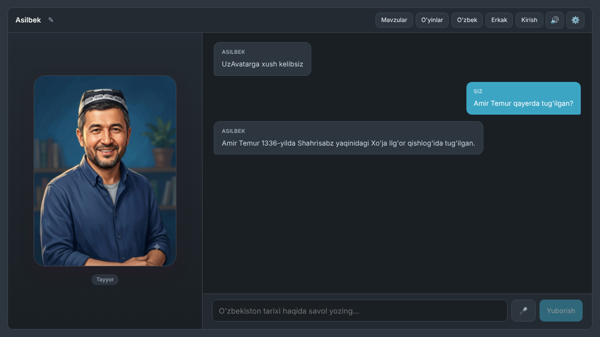

# UzAvatar: an AI teacher for Uzbek history and culture

UzAvatar is a bilingual (Uzbek and English) web app where an illustrated AI
teacher, **Asilbek**, answers questions about Uzbek history, culture and
traditions. Answers are grounded in a curated knowledge base, can be read
aloud in Uzbek, and the avatar's mouth moves with the speech.

I made it as a capstone project, with the goal of helping preserve and teach
the Uzbek language and history. Along the way it became a study of a practical
question: how do you make an AI teacher for a lower-resource language that
answers from checked sources instead of guessing?

**Live demo:** [uzavatar.onrender.com](https://uzavatar.onrender.com)
(free hosting: the first visit can take about a minute to wake the server, and
the AI has a small daily answer limit).



## What it does

- **Bilingual chat.** Ask in Uzbek or English; the answer comes back in the same language.
- **Answers from a curated knowledge base.** 12 Markdown files on history, scholars, cities, language, crafts and modern history (`knowledge/`). Each question retrieves the 4 most relevant passages, which are given to the model. See [How it works](#how-it-works).
- **Uzbek voice with lip-sync.** Uzbek answers are spoken by an open-source Uzbek speech model running locally, sentence by sentence so speech starts quickly. The avatar's mouth follows the audio. English uses the browser's built-in voices.
- **Customisable teacher.** Male or female portrait and voice (Asilbek or Dilafruz), and any name you like. The Uzbek speech model has only a female voice so far.
- **Topics and a quiz game.** Six topic shortcuts, and *Duels*: 5 AI-generated multiple-choice questions against a 60-second timer per question.
- **Accounts.** Sign in to keep a chat history sidebar and your chosen avatar name across devices, with password reset by email.
- **Voice input** through the browser's speech recognition (Chrome or Edge).

## Evaluation

I measured the retrieval step with 95 test questions in Uzbek and English.
Splitting documents by their headings raised the share of questions whose
best passage ranked first from **88.2% to 97.1%**, and halved the text sent
to the model. The tests also showed that similarity scores cannot tell when
the knowledge base lacks the requested fact, which shaped the next step of the
project.

Full method, results and limits: **[docs/evaluation.md](docs/evaluation.md)**.

## How it works

```
Browser (React)
  │  question
  ▼
Express server ──► Gemini embeddings ──► search the knowledge-base index
  │                                      (server/data/vectors.json)
  │  question + top 4 passages
  ▼
Gemini chat model ──► answer ──► browser
                                   │ Uzbek answer
                                   ▼
                     Local Uzbek speech service (port 8000) ──► audio + lip-sync
```

- **Frontend:** React and Vite (`src/`). Sign-in and chat history use Supabase.
- **Backend:** Node.js and Express (`server/`). The API key stays on the server.
- **Knowledge base:** `knowledge/*.md`, split into one piece per heading section (`server/lib/chunking.js`) and embedded with `gemini-embedding-001`.
- **Retrieval:** cosine similarity over all pieces, top 4 sent to the model (`server/lib/knowledge.js`, `server/chat.js`).
- **Speech:** `tts-service/` wraps an Uzbek VITS speech model in a small FastAPI service. Lip-sync analyses the audio itself (`src/lib/lipsync.js`), so it works for any language.

## Run it locally

Requirements: Node.js, a Gemini API key, and a Supabase project for sign-in.

```bash
npm install
cp .env.example .env      # then fill in the values
npm run index             # optional: rebuild the search index after editing knowledge/
npm run dev               # app at http://localhost:5173
```

Without a Gemini key the app runs in demo mode with prewritten answers.

Sign-in and chat history need a Supabase project with `conversations` and
`messages` tables (see `src/lib/history.js` for the fields used).

The Uzbek voice is optional and runs separately. See
[tts-service/README.md](tts-service/README.md). Without it, Uzbek answers use
the browser's voice.

To deploy, run `npm run build`; `npm start` then serves the built app and the
API from one server.

## Credits

- **Chat and embeddings:** Google Gemini API.
- **Uzbek speech model and its helper code:** [3936010/STT-TTS-Uz](https://github.com/3936010/STT-TTS-Uz). They are not included in this repository; only my service wrapper (`tts-service/tts_service.py`) is.
- **Knowledge base:** `knowledge/`. Each English file lists its sources at the end.
- **Libraries:** React, Vite, Express, Supabase.
- **Avatar portraits:** AI-generated images (most likely made with ChatGPT; the exact tool was not recorded).

## How this was built

Most of the code was written with AI coding assistants (Claude and Cursor),
and ChatGPT and Claude helped plan the evaluation. I decided what the app
should do, directed and checked the changes, tested it, deployed it and ran
the evaluations.

## License

Copyright © 2026 Ayubkhon Akhadov. All rights reserved. The code is public so
it can be viewed; please ask before reusing it. See [LICENSE](LICENSE).
